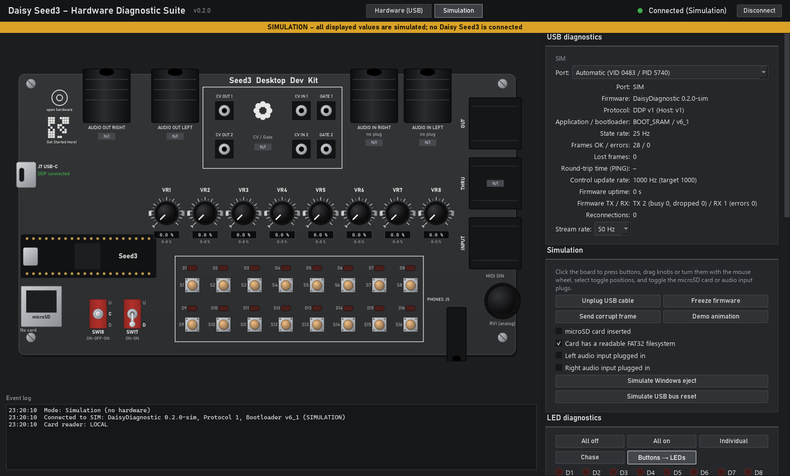

# Installation and usage

For the optional writable USB card-reader variant, see
[SD_CARD_READER.md](SD_CARD_READER.md). The regular diagnostic image stays
strictly read-only; its disabled reader controls explain which firmware is needed.



*Simulation screenshot: all values are simulated; no hardware is connected.*

## 1. Requirements

* Seed3 Desktop Development Kit and a USB-C **data** cable.
* Windows 11. Windows 10 is expected to work but has not been tested.
* Daisy bootloader **v6.x External** on the Seed3.
* `DaisyDiagnostic.bin` and `DaisyDiagnostic.exe`, built locally or downloaded
  from a successful [Hardware diagnostics run](https://github.com/sscheidl/Daisy-Seed3-Desktop-Diagnostics/actions/workflows/diagnostics.yml).

Windows normally binds CDC devices to `usbser.sys` as a USB Serial Device (COMx).

## 2. Bootloader installation, only if needed

The diagnostic firmware does **not** install a bootloader. Skip installation if a
suitable external v6.x bootloader already exists, for example from Toy Piano.
Follow [FLASHING.md](FLASHING.md): connect through the **Seed3 module's USB-C port**,
hold BOOT while pressing RESET, then choose **v6.x (external)** in the
[Daisy Web Programmer](https://flash.daisy.audio/).

## 3. Flash the application through J7

1. Connect the computer to **J7 on the Desktop carrier**, above the Seed3.
2. Press and release **RESET**, then press **BOOT** within about two seconds.
   The USR LED blinks quickly, then pulses slowly while the bootloader waits.
3. In the Web Programmer, connect, choose **Custom**, and upload `DaisyDiagnostic.bin`.
   Alternatively:

   ```bash
   dfu-util -a 0 -s 0x90040000:leave -D DaisyDiagnostic.bin -d ,0483:df11
   ```

4. After startup, the Seed3 USR LED blinks slowly (1 Hz) while waiting for the
   application. Buttons already control their corresponding LEDs in the default
   **Buttons → LEDs** mode, even without the PC application.

Flashing the diagnostic application replaces Toy Piano. Flash Toy Piano's `.bin`
to switch back; the existing bootloader is retained.

## 4. Start the Windows application

Double-click `DaisyDiagnostic.exe`. The EXE is unsigned, so Windows SmartScreen
may show a warning. From source, install Python 3.12 and run:

```bash
cd windows
python -m pip install -r requirements.txt
python -m daisy_diag
python -m daisy_diag --sim
python -m daisy_diag --port COM5
```

Options: `--sim`, `--port COMx`, `--selftest SECONDS` (exit 0 only if device data
was received), and `--screenshot FILE` (save a window image before the selftest exits).
Use `--help` for the English command-line reference.

## 5. Operation

### Connection

* **Hardware (USB)** scans every second for VID `0483`, PID `5740`, then verifies
  the device with a HELLO handshake. Other STM32 devices sharing this ID are
  skipped after a one-second handshake failure and backed off for five seconds.
* Choose a fixed port in the selector; a star marks a possible Daisy device.
* States are **Connected**, **Connecting**, **Disconnected**, **Connection error**,
  and **Incompatible protocol**. Normal receive timeout is 1.5 s; an explicitly
  requested SD test gets up to 20 s.
* The panel shows firmware/protocol/bootloader information, state rate, frame
  errors, lost frames, PING round-trip time, control rate (target 1000 Hz), and
  reconnection count.
* **Disconnect** also pauses automatic discovery. **Connect** resumes it.
  An unexpected USB disconnection triggers automatic reconnection.

### Board view

* **S1–S16:** two rows of eight buttons with pressed-state highlighting.
* **D1–D16:** red means the **commanded ON state**, not measured light output.
* **VR1–VR8:** knob position, percentage, and gray min/max markers since connection.
* **SW17/SW18:** two-/three-position toggles with U/C/D labels.
* **microSD:** No card / Card detected / Filesystem readable / Error.
* **Audio inputs:** plug indicators. **Audio outputs have no jack detection.**
* Gray **N/I** labels mark unimplemented functions; tooltips explain them.

### LED diagnostics

Modes: **All off**, **All on**, **Individual**, **Chase**, and **Buttons → LEDs**.
Toggle D1–D16 using checkboxes or the board drawing. Adjust brightness from 0–100%
and the chase step interval. The LEDs have no electrical feedback: inspect the
physical board to verify light output and brightness.

### microSD

**Start read test (read-only)** mounts the filesystem, counts up to 1,000 entries
in the root directory, and unmounts it. No writing or formatting occurs. Results
show filesystem type, size, entry count, or a FatFs error. Streaming pauses during
the test. Reads have a five-second budget plus initialization; the host allows
up to 20 seconds for the result.

### Other panels

Toggle/plug status, knob percentage and raw ADC table with resettable min/max,
press counts, planned **Not implemented** features, and the event log.

### Simulation

Select **Simulation** or start with `--sim`. A yellow banner marks simulated data.
Click buttons, drag knobs or turn the mouse wheel, select toggle positions, and
toggle microSD/audio input plugs. Controls simulate USB unplug/replug, frozen
firmware, corrupt frames, demo animation, and cards with/without a filesystem.
The model uses the same wire protocol; it is not a replacement for real hardware.

## 6. Troubleshooting

| Symptom | Check |
| --- | --- |
| No Daisy found | Use J7 and a data cable; check firmware and Windows Device Manager |
| Port found, no DDP reply | Another application or bootloader may be running; flash diagnostic firmware and reset |
| Cannot open port | Close terminals, Web Programmer connections, and other applications using it |
| Incompatible protocol | Match firmware and Windows application protocol versions |
| Timeout after 1.5 s | Firmware or USB stopped responding; automatic reconnection follows |
| Control rate far from 1000 Hz | Check the audio/codec configuration and record the event log |

See [TEST_REPORT.md](TEST_REPORT.md) for recorded hardware results and remaining limits.
